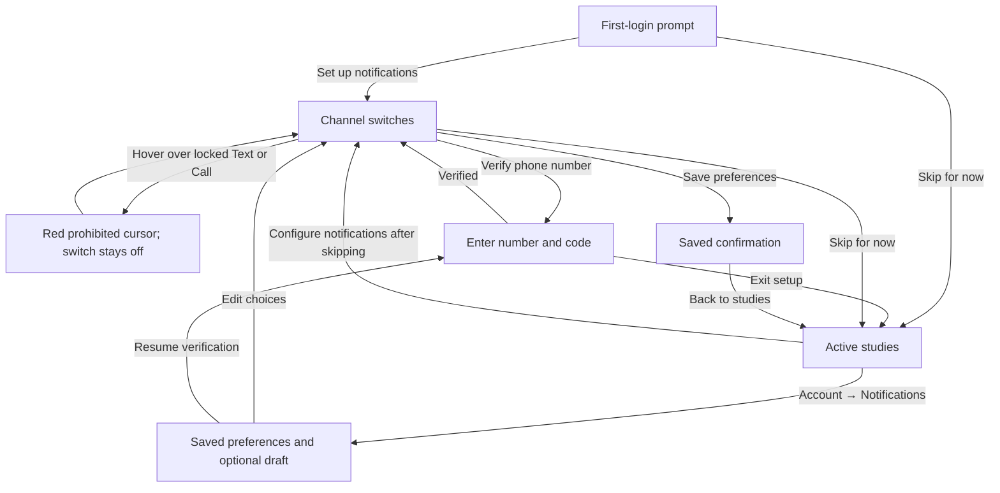

# Notification setup — product proposal for review

**Status:** Design prototype only. [Open the clickable prototype](./notification-setup-prototype.html). The participant app has not been changed by this design revision.

The entire desktop prototype uses a light canvas, horizontal case tabs, consistent green accents, and compact dialogs for the invitation, choices, verification, and confirmation. The choices card follows the supplied reference: a compact white card, green actions, channel icons and switches, a phone verification panel, and a separate footer with **Skip for now** and **Save preferences**. Earlier static previews are superseded. Select a case in the tabs across the top; the demo verification code is `123456`.

## Choices and saving

- Email, Text messages, and Phone calls have independent on/off switches. New setups start with every switch off.
- Text and Call switches are greyed out until the user verifies a phone number. Hovering over either locked switch shows a red prohibited cursor. The switches are disabled, and the inline explanation says to verify the phone first. Clicking does not enable them or show an alert badge.
- **Verify phone number** opens number and code entry. Verification returns to the choices card, unlocks both switches, and does not turn either on automatically.
- **Save preferences** saves directly from the card. There is no separate review page. Saving with every channel off is a completed setup.
- Switching a channel on edits the draft only. The saved choice becomes active after Save preferences. Previous saved preferences remain active while an edit is unfinished.

## Entry and exit

| Case | Behavior |
| --- | --- |
| First login | A compact optional prompt asks whether to set up notifications. Set up notifications opens the choices card; Skip for now returns directly to Active studies. |
| Skip from the choices card | Discard the setup draft and go directly to Active studies. No new preferences are saved. |
| Exit halfway through verification | Go directly to Active studies. Retain the draft and current step for later resumption through Account → Notifications. |
| Edit existing preferences | Open switches with saved values. Save preferences applies changes; exiting leaves saved values active and retains the edit draft. |
| Return after skipping | Go directly to the study home, with a light green optional-notifications banner above the studies. Configure notifications opens the choices card directly. The initial dialog does not repeat; the account menu remains available. |
| Verification error | Keep the user on code entry with an inline error, Edit number, and Resend code. No phone channel becomes enabled. |

The skipped-setup banner appears after skipping the invitation or the choices card and persists on return visits. It disappears after preferences are saved, including an all-off save. An unfinished verification draft still returns to the normal study home and is resumed through Notifications.

Skipping is distinct from saving all switches off: skipping leaves preferences unset; saving records an explicit off value for each channel. In this standalone prototype, demo state persists locally in the browser and does not change an account.

## Screen map

